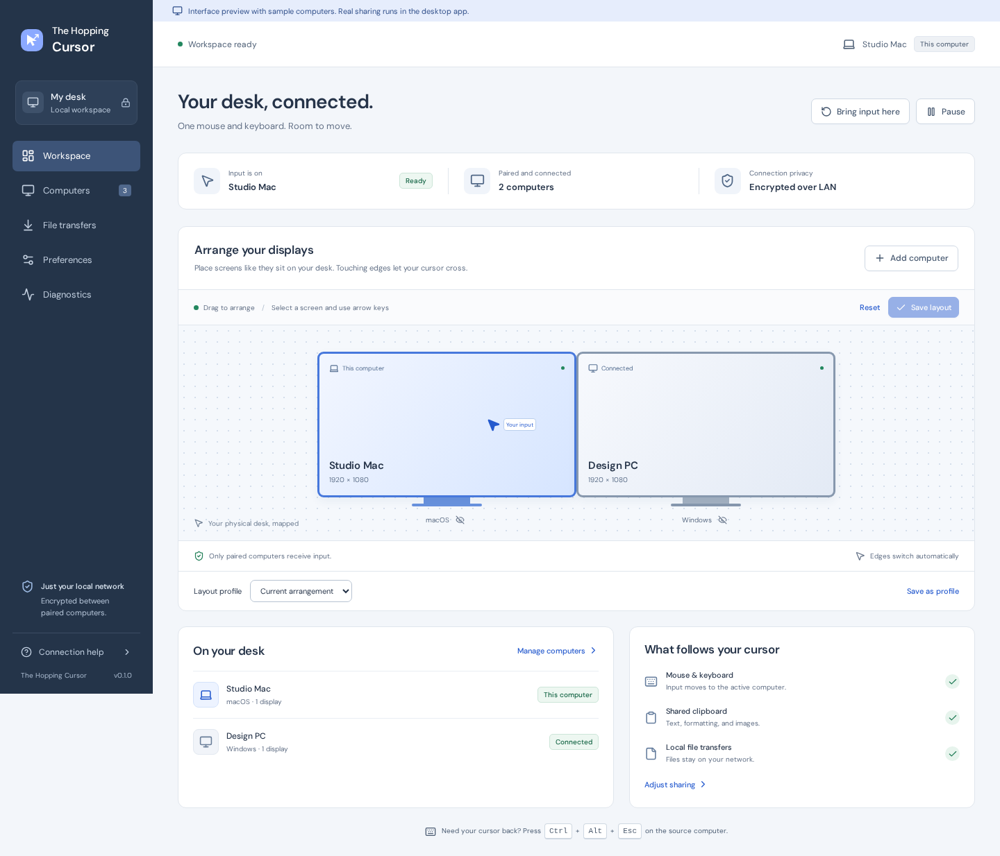

# The Hopping Cursor

A desktop application for sharing a mouse, keyboard, clipboard, and files between your own computers on a local network. A Rust engine, native Windows and macOS input adapters, and a Tauri/React control interface. Independently implemented from public product research; no proprietary code or assets used.

**Status: development alpha.** The encrypted engine and desktop controls are implemented. Windows x64 and Intel/Apple Silicon Mac installers have built successfully on native GitHub runners. Most engine tests use an in-memory OS adapter; isolated Mac pasteboard tests exercise native APIs; actual Windows/macOS input and permission behavior still require the hardware checklist below. This is not yet a production replacement for a mature software KVM.



## What's built

- Noise XX encryption, persistent identities, matching safety codes, explicit approval on both computers, pinned keys, and revocation. No cloud account.
- mDNS discovery as an untrusted hint, manual private-IP connection, remembered authenticated addresses, trusted-only reconnection, deterministic simultaneous-connection recovery, heartbeat RTT, and input recovery on disconnect.
- Edge-based cursor routing with offset/stacked displays, coordinate scaling, hidden displays, configurable edge delay, sensitivity, and per-monitor hop shortcuts.
- Windows hooks/SendInput and macOS CGEventTap/CGEventPost adapters; keyboard forwarding, common physical-key mapping, mouse buttons/scroll, injected-event filtering, held-key handoff, and Ctrl+Alt+Escape emergency recovery.
- Plain text, HTML, and PNG clipboard exchange on separate encrypted bulk connections, type controls, per-peer permissions, bounce suppression, and source clipboard privacy-marker checks.
- Streamed file transfers, app-window drag/drop, recipient approval, progress, cancellation, SHA-256 verification, duplicate-name protection, quotas, and bounded concurrency. Explicit “Send copied files” and “Copy file for pasting” actions bridge native file lists without trusting remote paths.
- Desktop pairing, draggable/keyboard-accessible layout editor, saved layout profiles, hotplug refresh, stable macOS UUID / Windows monitor interface identifiers, single-instance window reopening, computer management, transfers, preferences, diagnostics, and tray controls. Cursor lock and basic edge-blocking game mode.
- Windows NSIS and Intel/Apple Silicon macOS DMG installers and build workflow in GitHub Actions. Installers are unsigned development builds; build success is not evidence of physical two-computer validation.

## What's still missing

Native Finder/Explorer file dragging across screen edges, automatic file-clipboard synchronization and folder/file-promise support; hardware display dimming; synchronized lock/wake/session state; raw relative gaming input; secure desktop/UAC/login input on Windows; media/vendor keys; code signing/notarization; measured latency/throughput and external security review. There is no commercial license/billing system in this alpha.

The research is in [replica/recon.md](replica/recon.md). Native limitations and acceptance steps are in [docs/PLATFORM_TESTING.md](docs/PLATFORM_TESTING.md). Security design and trust boundaries are in [docs/SECURITY.md](docs/SECURITY.md).

## Try the desktop app

Requirements: Node.js 22+, current stable Rust, and native build prerequisites. Windows: Microsoft C++ Build Tools and WebView2. macOS: Xcode Command Line Tools. Both computers need the app, a private LAN, and access through their firewalls.

```sh
git clone https://github.com/Itskorrah/The-hopping-cursor.git
cd The-hopping-cursor
npm ci
npm run desktop
```

On macOS, use **Grant permissions / Retry** to request **Accessibility** and **Input Monitoring**, and allow **Local Network** access when prompted. Approve these in System Settings, then retry or restart if macOS requests it. Start on a private test LAN with non-sensitive text and files. Use a local mouse on each computer during testing.

1. Open Computers on both machines. Discovery uses mDNS; if needed, use Add computer with a local address such as `192.168.1.20:24810`.
2. Pair the computer, compare the **entire safety code** on both screens, and approve it on **both**. One-sided approval does not permit sharing.
3. Arrange your displays with touching edges and save. Each computer currently keeps its own layout; configure both if you want to drive from either side.
4. Move toward a shared edge. Your keyboard follows the cursor. Use **Ctrl+Alt+Escape** on the source computer to bring input back immediately.
5. Send files from File transfers or drop them into the app window. The receiver accepts the offer. Completed files go to the receiving folder in Preferences. To send files copied in Finder/Explorer, use **Send copied files**. A verified received file offers **Copy file for pasting** into another folder.

Select a monitor to assign **Ctrl+Alt+1–9** hop shortcuts or use **Jump here**. Save named layout profiles for different desks. Pair permissions separately control input, clipboard, and files. **Pause** returns input locally, stops sharing, and cancels pending/active file transfers.

Identity keys migrate into macOS Keychain or user-bound Windows DPAPI storage without changing pairings. A locked/missing protected identity fails startup rather than silently generating a new one. Linux/headless test configurations retain permission-restricted file storage.

Closing the window keeps the engine in the tray. **Quit** from the tray stops sharing and releases input. Display changes are checked every two seconds; input returns locally and peers reconnect with fresh display metadata. Saved profiles are reconciled against attached displays. Driver/port changes and identical monitors still need hardware validation. Default networking is TCP **24810**, mDNS UDP **5353**. No port forwarding is needed. Guest Wi-Fi/client isolation may block peers.

Build installers locally:

```sh
npm run desktop:build
```

Or open [GitHub Actions](https://github.com/Itskorrah/The-hopping-cursor/actions), select a successful **Build and verify** run, and download the Windows x64, macOS ARM64, or macOS Intel artifact. The workflow builds on native runners. Successful build artifacts are development packages, not signed public releases.

Extract the artifact and find the `.exe` or `.dmg` under `target/.../release/bundle/`. The archive also includes the application license and dependency notices.

## Browser interface preview

```sh
npm ci
npm run dev
```

Open `http://localhost:1420`. The visible preview banner explains that the computers are samples. Pairing examples, layouts/profiles, and preferences use local browser storage. Real OS input/network/file operations run only in the desktop app. No fabricated latency values are displayed.

## Headless engine and CLI

Linux supports encrypted protocol/transfer development and integration tests; it does **not** support global input capture in this version.

```sh
cargo run -p hopping-cursor -- identity
cargo run -p hopping-cursor -- daemon
```

For manually configured peers, compare each public identity directly on the other computer, then run this on **both** with the other machine's public key:

```sh
cargo run -p hopping-cursor -- trust --public-key OTHER_PUBLIC_KEY --address 192.168.1.20:24810 --name "Other computer"
cargo run -p hopping-cursor -- daemon --connect 192.168.1.20:24810
```

Use `--config-dir /absolute/path` before the command for an isolated development instance. `daemon --port 24811` overrides the listen port for that run. The `send --peer DEVICE_ID path/to/file` command starts a temporary engine; avoid running it concurrently against an actively edited desktop configuration.

## Verify

```sh
cargo test
cargo clippy -p hop-core -p hopping-cursor --all-targets -- -D warnings
cargo fmt --all -- --check
npm run build
npx playwright install chromium
npm run test:ui
```

The current suite has **42 Rust tests on macOS and 10 browser tests**. Rust checks include real encrypted TCP services, ciphertext tampering/replay rejection, fragmented packets during simultaneous input/heartbeats, saturated-queue emergency release, pairing/revocation, recipient consent, byte-for-byte transfers, duplicate filenames, clipboard exchange, held-key handoff, hop shortcuts, and pause/disconnect recovery. Browser tests cover preferences, pairing consent, arrangement, profiles, permissions, shortcuts, accessibility, and small-screen layout. Two additional native Mac checks use isolated pasteboards for file URLs and privacy markers without replacing your clipboard. These checks do not substitute for cross-application or physical multi-computer testing.

Dependency audit results and remaining warnings are recorded in [docs/SECURITY.md](docs/SECURITY.md). The prioritized path from this alpha to a release is in [docs/ROADMAP.md](docs/ROADMAP.md); the research feature matrix is in [replica/features.csv](replica/features.csv).

## Project map

```text
crates/hop-core/             Protocol, trust, routing, native adapters, transfers
crates/hop-cli/              Headless/native engine CLI
apps/desktop/src/            React desktop controls and explicit browser preview
apps/desktop/src-tauri/      Tauri IPC, tray, packaging, app icons
replica/                    Public research, architecture, skills, parity tracking
docs/                       Security model and physical-platform test checklist
.agents/skills/             Your Replica Universal pack and frontend design skill
.github/workflows/          Core/browser checks and native installer builds
```

The Replica pack was installed from [your repository](https://github.com/Itskorrah/replica-skill-universal). Additional skill discovery used [Vercel find-skills](https://skills.sh/vercel-labs/skills/find-skills); details are in [replica/skills.md](replica/skills.md).

Original application code is MIT licensed. Installed skills preserve their own licenses; dependencies and fonts retain their respective licenses. [Bundled notices](apps/desktop/public/THIRD_PARTY_NOTICES.txt) accompany installer artifacts and the app assets. Regenerate with `python3 scripts/generate-notices.py` after changing dependencies. The name is provisional; trademark/domain checks have not been performed.

## Local verification (2026-10-09)

42 Rust tests and 10 Playwright browser tests pass on Apple Silicon macOS.
Strict Clippy passes locally, and the Windows/Intel adapters are cross-checked.
The native debug app launches; Keychain migration preserved the existing public
identity and removed the private key from JSON. This does not validate native
input across physical computers. Native CI checks and packages all three targets.

The loopback tests disable multicast so independent tests cannot discover one
another. Run the dedicated real-mDNS check separately on an isolated private LAN:

```sh
cargo test --locked --test discovery -- --ignored
```

Recovery also suspends input for unavailable displays/permissions and protected input sessions, and clears stale ownership/keys after timing gaps. This is safety recovery, not synchronized lock/wake control.

A bounded AddressSanitizer parser fuzz run completed 1,770,886 cases without a crash; see [fuzz/README.md](fuzz/README.md) for scope and commands.

The CLI supports `daemon --no-discovery` for manual/remembered connections.
See [docs/DEVELOPMENT_STATUS.md](docs/DEVELOPMENT_STATUS.md) for detailed evidence.
