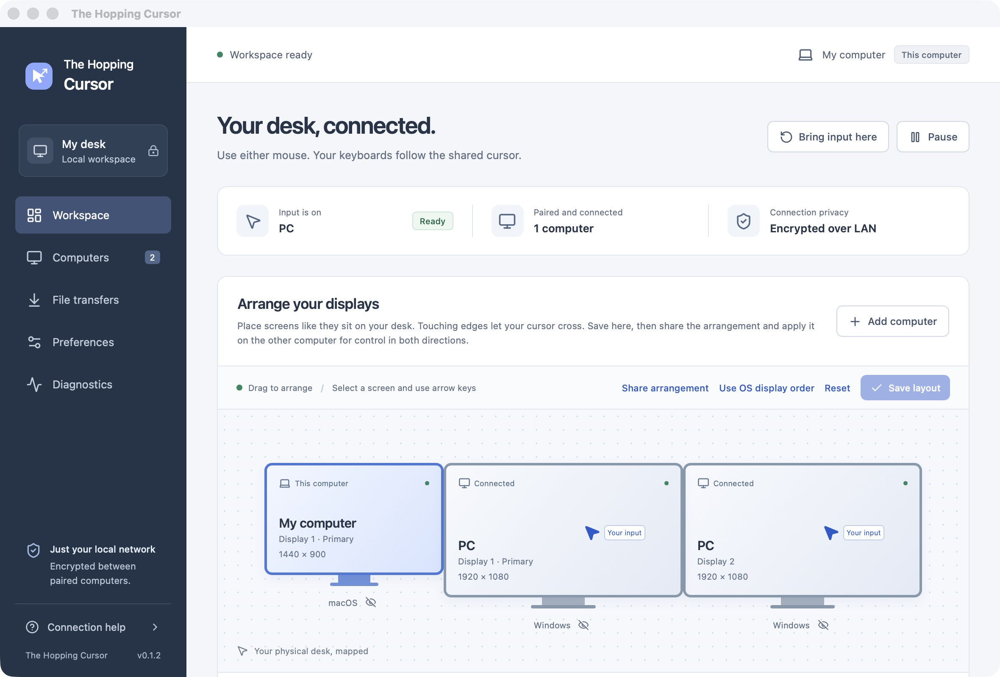
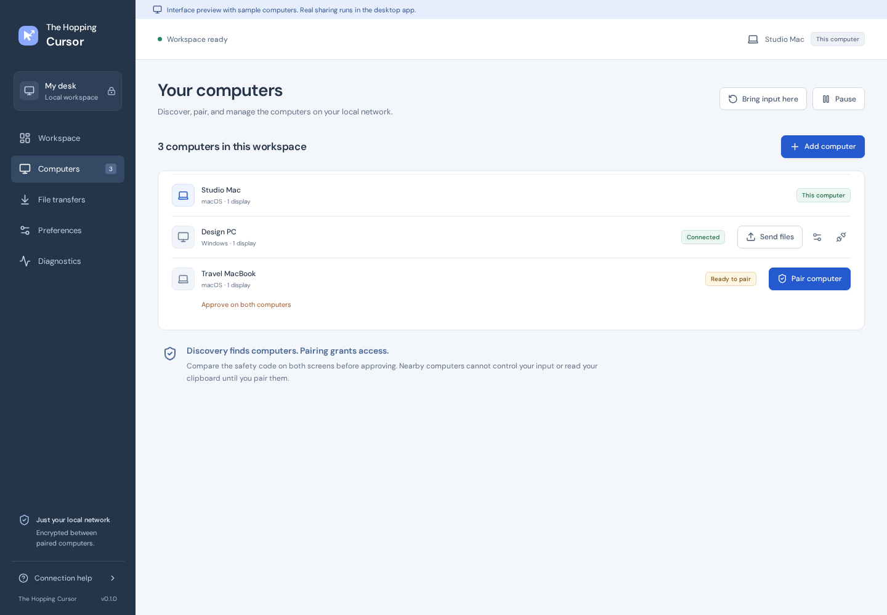

  

  <h1>The Hopping Cursor</h1>

  
<strong>One desk. Multiple computers. One cursor.</strong>

  

    A local-first desktop app for sharing a mouse, keyboard, clipboard and files
    between <strong>Windows</strong> and <strong>macOS</strong>.
    No cloud account. No external relay. Just your computers, working together.
  

  

    
    
    
    
  

  

    <a href="#get-started">Get started</a> ·
    <a href="#features">Features</a> ·
    <a href="#security-and-privacy">Security</a> ·
    <a href="#development-and-verification">Development</a> ·
    <a href="docs/ROADMAP.md">Roadmap</a>
  

---

> [!IMPORTANT]
> **Development alpha · v0.1.6 source tree.** The core application is implemented and basic Windows↔Mac control has been user-reported, but broader physical input, cursor visibility, permissions and reconnect testing remains open. Current packages are **not signed or notarised for public production distribution**. This is a project for controlled testing, not yet a dependable replacement for a mature software KVM.

## See it in action

  

Actual native macOS workspace captured during the October 2026 alpha. Not a browser mock-up; some controls have since evolved.

The Hopping Cursor brings your displays into one workspace: move across a configured screen edge to hand input to a paired computer, or jump directly to a specific monitor. Each machine keeps running its own operating system and applications.

<strong>View the Computers and pairing screen</strong>

 

## Features

| | |
| --- | --- |
| **Move between computers** | Edge-based mouse handoff, keyboard following the active pointer, per-monitor hop shortcuts and an emergency return-to-local shortcut. |
| **Make complex desks feel simpler** | Arrange offset or stacked monitors, exclude displays from routing, save named layouts and explicitly share arrangement proposals. |
| **Pair on your terms** | Find devices over local-network discovery or connect by private IP. Verify the full safety code on both computers, approve each side and revoke access at any time. |
| **Keep the clipboard moving** | Exchange text, HTML and PNG images through encrypted connections, with per-peer and per-content controls and source privacy-marker checks. |
| **Send files deliberately** | Encrypted, consent-based file transfers with progress, cancellation, size controls, SHA-256 verification and collision protection. Drop files **into the app window** or use file-clipboard actions. |
| **Stay in control** | Pause sharing, bring input home, reconnect peers, configure permissions and inspect privacy-conscious diagnostics without recording typed keys or clipboard contents. |

### Current capabilities and maturity

| Area | State | What that means |
| --- | --- | --- |
| Encrypted local connections and mutual pairing | **Implemented** | Noise XX, pinned peer identities, safety-code verification and explicit approval have automated protocol coverage. |
| Windows↔Mac mouse and keyboard sharing | **Alpha** | Native adapters and input recovery exist; basic control was user-reported, but extended two-device regression testing is incomplete. |
| Multi-monitor layouts and monitor shortcuts | **Alpha** | Saved layouts and routing tests exist; unusual hardware, docks and scaling combinations still need physical validation. |
| Clipboard and regular-file exchange | **Implemented; OS acceptance ongoing** | Encrypted transfer and consent paths have integration tests. Native cross-application behaviour needs broader tests. |
| Native Finder/Explorer drag across screen edges | **Not available** | Dropping into this app is supported; dragging a file directly from one OS into an app on the other is not. |
| Windows and macOS development installers | **Available for testing** | Windows NSIS and macOS DMG builds have been produced. Public signing, notarisation and release validation are unfinished. |
| Linux desktop input sharing | **Not available** | Linux is currently a headless engine/protocol test target, not a global-input desktop client. |

For the complete feature inventory, see [feature parity](replica/features.csv) and the [release roadmap](docs/ROADMAP.md).

## Get started

### 1. Check your setup

| | Requirements |
| --- | --- |
| **Windows** | x64 desktop, Microsoft C++ build prerequisites and WebView2 |
| **macOS** | macOS 12 or later, Intel or Apple Silicon, Xcode Command Line Tools |
| **Both** | Node.js 22+, a stable Rust toolchain, and two computers reachable on the same private local network |

The app must run **on both computers**. Allow it through your local firewalls. Discovery uses mDNS (UDP 5353); the default application connection uses TCP **24810**. No router port forwarding or internet relay is required. Guest Wi-Fi/client isolation can prevent discovery and connection.

For full platform prerequisites, see [Building test installers](docs/BUILDING.md).

### 2. Run the desktop app from source

Clone the repository using an account with access:

~~~bash
git clone https://github.com/Itskorrah/The-hopping-cursor.git
cd The-hopping-cursor
npm ci
npm run desktop
~~~

Run these commands on **each** computer. The first build requires the native dependencies listed above.

**macOS:** Choose **Grant permissions / Retry** in the app, then allow **Accessibility**, **Input Monitoring** and, when prompted, **Local Network** in System Settings. You may need to restart the app after changing permissions. Mac debug builds use ad hoc signing; rebuilding can require re-approving app permissions.

**Windows:** Ensure the native development prerequisites and Windows firewall permission are present. Input hooks cannot control UAC/secure desktops or the Windows login screen.

> [!NOTE]
> **Prefer an installer for testing?** A historical [Windows v0.1.5 test package](https://github.com/Itskorrah/The-hopping-cursor/releases/tag/v0.1.5-test.1) is available. It is **unsigned and not a production release**. Build the corresponding macOS development app from source; see [packaging instructions](docs/BUILDING.md). The macOS 0.1.6 cursor correction was designed to work with Windows 0.1.5. Verify app versions before reporting a cross-machine bug, and preserve existing identities and settings when updating.

### 3. Connect and share a workspace

1. **Pair securely.** Open **Computers** on both machines. Use discovery or **Add computer** with a private address (for example, `192.168.1.20:24810`). Compare the **entire safety code** on both screens and approve on **both** devices.
2. **Arrange your monitors.** Open **Workspace**, position the displays so their intended crossing edges touch and save. Use **Share arrangement** to offer the layout; the receiving computer must explicitly accept it.
3. **Start sharing.** Resume sharing on both devices, then move your pointer towards a connected edge. Your keyboard follows the active controller. You can also select a monitor and use **Jump here** or assign **Ctrl+Alt+1–9** hop shortcuts.
4. **Always know how to recover.** Press **Ctrl+Alt+Escape** on the **source computer** to return control locally. **Pause** also returns input locally and stops active sharing. Keep access to a local mouse and keyboard on each machine during alpha testing.
5. **Move a file.** Open **File transfers** or drop a file into the application window. The recipient must accept it. For files copied in Finder/Explorer, use **Send copied files**; a verified received file can be **copied for pasting**.

Closing the main window leaves the sharing engine running in the tray. Use **Quit application** or the tray's **Quit** action to stop it completely. Use non-sensitive test data during initial setup.

## Security and privacy

**A local-first design, not a claim of a completed security audit.**

- **Encrypted by design.** The control and file/clipboard channels use Noise `XX_25519_ChaChaPoly_SHA256`. There is no plaintext fallback.
- **No cloud identity.** There is no hosted account, analytics backend or internet relay. Discovery advertisements on your LAN still reveal device metadata such as the computer name and address.
- **Trust is explicit.** Both machines must approve matching identity safety codes. Public keys are pinned, and unpairing revokes the relationship.
- **Private keys stay local.** Native identity material is stored through macOS Keychain or Windows user-bound DPAPI, with conservative handling if protected storage is unavailable.
- **Permissions are scoped.** Input, clipboard and file sharing can be controlled per peer. Incoming files require consent by default, are verified before publication and are never automatically opened.
- **Safe failure matters.** Heartbeat loss, disconnects, session/permission changes and **Ctrl+Alt+Escape** trigger conservative input-release paths.

**Important boundaries:** Unmarked secrets on the clipboard can still be shared. The application cannot protect against malware already running as your user. Initial LAN advertisements are not anonymous. A third-party security assessment and full native hardware testing are outstanding.

Read the [security model](docs/SECURITY.md) for the threat model, key handling, input recovery, limits and recorded dependency advisories.

## Development and verification

The source combines a Rust engine with native Windows/macOS input backends and a Tauri 2 + React/TypeScript desktop interface.

~~~text
crates/hop-core/             Transport, pairing, routing, clipboard, native input, transfers
crates/hop-cli/              Headless engine and diagnostic CLI
apps/desktop/src/            React / TypeScript desktop interface
apps/desktop/src-tauri/      Tauri shell, IPC, system tray and native packaging
docs/                       Security, setup, physical acceptance and dated test evidence
replica/                    Product research, architecture and feature-tracking records
~~~

### Run local checks without GitHub Actions

Hosted GitHub Actions allocation may be unavailable. The repository includes an independent local verifier:

~~~bash
node scripts/verify-local.mjs --dry-run
node scripts/verify-local.mjs
# Optional, on Windows/macOS with their native toolchains:
node scripts/verify-local.mjs --native
~~~

The verifier invokes Node smoke tests, Rust formatting, strict Clippy, Cargo tests, TypeScript checking, the frontend build and Playwright. Install dependencies with `npm ci` and Playwright Chromium with `npx playwright install chromium` first. It reports failing and missing steps rather than declaring an incomplete run successful.

For individual development commands:

~~~bash
cargo test --locked
cargo fmt --all -- --check
cargo clippy --locked -p hop-core -p hopping-cursor --all-targets -- -D warnings
npm run typecheck
npm run build
npm run test:ui
~~~

**Evidence, not assumptions:** The [dated 0.1.6 Mac report](docs/TEST_0.1.6.md) records 75 passing default Rust tests, two separately invoked native cursor probes and 18 browser tests at that checkpoint. Those results are historical; they are not fresh verification of every current commit or a substitute for Windows↔Mac physical acceptance.

See [development evidence](docs/DEVELOPMENT_STATUS.md), [physical testing](docs/PLATFORM_TESTING.md) and [installer build instructions](docs/BUILDING.md).

### Explore the interface without native permissions

~~~bash
npm ci
npm run dev
~~~

Visit [http://localhost:1420](http://localhost:1420). This is a clearly labelled **browser preview** with sample computers and locally stored preview settings. It cannot pair devices, capture system-wide input or transfer real files. For those features, run the Tauri desktop application.

<strong>Working on the headless engine or protocol?</strong>

~~~bash
cargo run -p hopping-cursor -- identity
cargo run -p hopping-cursor -- daemon
~~~

Linux can run the encrypted headless network and transfer tests but does not have native global mouse/keyboard sharing here. For manual peer setup and isolated configuration directories, see the [development history](docs/README_HISTORY.md) or inspect `crates/hop-cli/`.

## What still needs work

The goal is a dependable cross-platform desktop experience. These are real boundaries, not hidden footnotes:

- **Physical reliability:** Complete extended Windows↔Mac acceptance for duplicate/hidden cursors, the first key after handoff, scrolling, modifier keys, international layouts, disconnect/reconnect, sleep/wake, permissions and mixed-DPI desks.
- **Windows-to-Mac shortcuts:** Alt+Tab → Command+Tab is under development in [PR #3](https://github.com/Itskorrah/The-hopping-cursor/pull/3), **not merged into `main`**. AltGr and non-US layouts still require careful native validation.
- **File workflows:** Native Finder/Explorer drag across screen boundaries, folders and file promises are not implemented. The current file transfer and file-clipboard workflows are explicit.
- **System integration:** No Windows secure-desktop/UAC input injection, synchronized lock/wake, hardware display dimming, complete media-key support or true raw/relative gaming input.
- **Distribution and assurance:** Installer signing/notarisation, tested automatic updates, external security review, measured end-to-end latency and broad hardware compatibility remain ahead.

macOS background cursor hiding currently uses a version-sensitive, undocumented WindowServer capability with a fail-safe path; future OS versions require retesting. See the [focused Mac acceptance report](docs/TEST_0.1.6.md) and [roadmap](docs/ROADMAP.md).

## Help, diagnostics and project documents

| Looking for… | Start here |
| --- | --- |
| **Something isn't working on a real computer** | [Physical testing and troubleshooting](docs/PLATFORM_TESTING.md) · [Mac 0.1.6 cursor checklist](docs/TEST_0.1.6.md) |
| **Windows or macOS installer instructions** | [Building and signing notes](docs/BUILDING.md) |
| **Security and trust boundaries** | [Security model](docs/SECURITY.md) |
| **How the engine works** | [Architecture](replica/architecture.md) |
| **What is implemented versus planned** | [Feature matrix](replica/features.csv) · [Roadmap](docs/ROADMAP.md) |
| **Recorded tests, investigations and older changes** | [Development evidence](docs/DEVELOPMENT_STATUS.md) · [Historical README release notes](docs/README_HISTORY.md) |

If you are collaborating in this repository, read [AGENTS.md](AGENTS.md) before changing native input, cryptography or trust behaviour. Reproduce bugs with harmless inputs, preserve existing pairing identities and include physical test conditions when reporting native failures. Report security vulnerabilities privately to the repository owner rather than publishing exploit details.

## License

The original application code is [MIT licensed](LICENSE). Third-party dependencies, fonts and bundled development skills retain their own licences; see the [third-party notices](apps/desktop/public/THIRD_PARTY_NOTICES.txt).

The Hopping Cursor is an independent implementation informed by public research. No proprietary competitor code or assets are included. The name remains provisional pending trademark and domain checks.

  Built for the way a real multi-computer desk should work — with usability, local control and careful engineering ahead of marketing promises.

